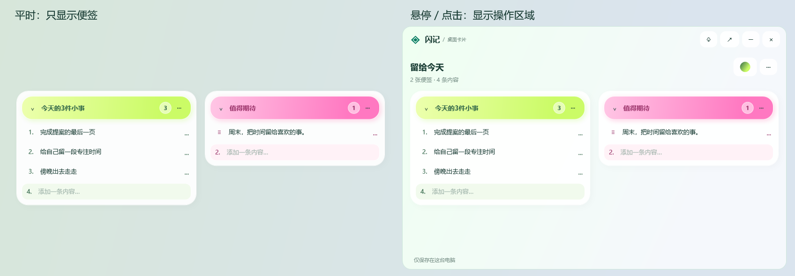

# 闪记 LumaJot

轻量的便签与待办工具，支持分区管理、多种配色和桌面小组件。

Mac 与 Windows 安装包通过本仓库的 [Releases](https://github.com/miloraJade/LumaJot/releases) 提供。请以各版本说明中的系统要求和测试状态为准。

## 下载 Windows 预览版

**[下载闪记 0.1.2 · Windows x64 安装程序（约 75 MB）](https://github.com/miloraJade/LumaJot/releases/download/v0.1.2-windows/LumaJot-0.1.2-Windows-x64-Setup.exe)**

[免安装便携版 ZIP](https://github.com/miloraJade/LumaJot/releases/download/v0.1.2-windows/LumaJot-0.1.2-Windows-x64-portable.zip) · [版本说明与全部附件](https://github.com/miloraJade/LumaJot/releases/tag/v0.1.2-windows) · [SHA-256 校验文件](https://github.com/miloraJade/LumaJot/releases/download/v0.1.2-windows/SHA256SUMS.txt)

适用于 Windows x64，已在 Windows 11 验证；自带 .NET 运行时，无需另外安装。升级前请保存输入框中的文字，并从右下角托盘退出旧版闪记，再运行安装程序。已有便签和同步设置保留。

桌面卡片平时只显示便签框；鼠标移入便签或按钮区域显示操作，移开约半秒后收起。支持独立置顶、缩放、紧凑排布，以及同步文件夹 / 坚果云连接。

> 当前为尚未进行 Windows 代码签名的预览版，首次运行可能显示未知发布者。桌面卡片是独立应用窗口；Win+W 系统小组件、定时 AI 周整理和系统提醒尚未提供。

## 下载 Mac 测试版

**[下载闪记 0.9.5 · macOS DMG（约 6.2 MB）](https://github.com/miloraJade/LumaJot/releases/download/v0.9.5-test/LumaJot-0.9.5-macOS-universal-test.dmg)**

[版本说明与全部附件](https://github.com/miloraJade/LumaJot/releases/tag/v0.9.5-test) · [SHA-256 校验文件](https://github.com/miloraJade/LumaJot/releases/download/v0.9.5-test/SHA256SUMS.txt)

支持 macOS 14.0 及以上，兼容 Apple Silicon 和 Intel Mac。DMG 仅适用于 Mac。

> 当前为测试版，使用 Apple Development 开发签名，尚未完成 Developer ID 分发签名和 Apple 公证，当前 Gatekeeper 评估未通过。其他 Mac 的安装和小组件共享行为仍需验证，安装时可能被系统拦截。请先阅读版本说明。

## 界面预览

以下截图全部使用虚构示例内容。Windows 为 0.1.2，苹果端为 0.9.5（build 26）。

### Windows · 桌面便签

以上为 Windows WPF 界面的实际渲染对比，使用示例背景与虚构便签。

### iPhone 与 iPad

<table>
  <tr>
    <th>iPhone · 分区总览</th>
    <th>iPhone · 便签详情</th>
    <th>iPad · 四色便签</th>
  </tr>
  <tr>
    <td></td>
    <td></td>
    <td></td>
  </tr>
</table>

以上三张为模拟器直接截图。

### 小组件

<table>
  <tr>
    <th>分区 · 多张便签</th>
    <th>单张便签</th>
  </tr>
  <tr>
    <td></td>
    <td></td>
  </tr>
</table>

这两张为当前版本的原生 SwiftUI 小组件渲染预览，非系统桌面截图。

[查看全部高清截图](docs/screenshots)