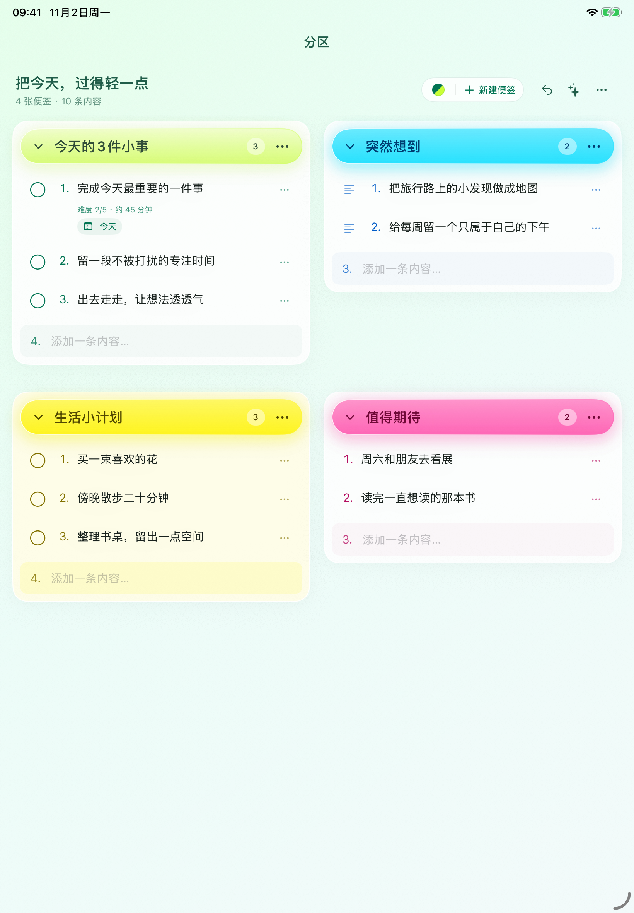
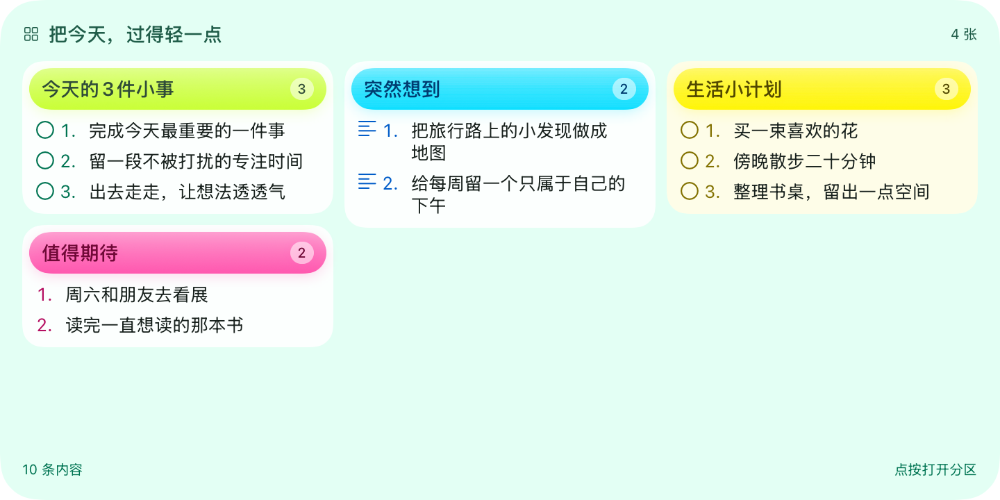

# 闪记 LumaJot

轻量的便签与待办工具，支持分区管理、多种配色和桌面小组件。

Mac 安装包通过本仓库的 [Releases](https://github.com/miloraJade/LumaJot/releases) 提供。请以各版本说明中的系统要求和测试状态为准。

目前正在准备 0.9.5 测试版，尚未发布正式安装包。

## 界面预览

以下展示 0.9.5（build 26）的界面，全部使用虚构示例内容。

### iPhone 与 iPad

<table>
  <tr>
    <th>iPhone · 分区总览</th>
    <th>iPhone · 便签详情</th>
    <th>iPad · 四色便签</th>
  </tr>
  <tr>
    <td></td>
    <td></td>
    <td></td>
  </tr>
</table>

以上三张为模拟器直接截图。

### 小组件

<table>
  <tr>
    <th>分区 · 多张便签</th>
    <th>单张便签</th>
  </tr>
  <tr>
    <td></td>
    <td></td>
  </tr>
</table>

这两张为当前版本的原生 SwiftUI 小组件渲染预览，非系统桌面截图。

[查看全部高清截图](docs/screenshots)